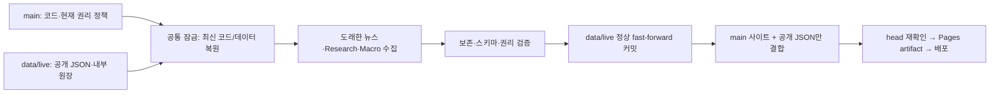

# Data Pipeline & Deployment Separation v1.0

**코드 구현·격리 시뮬레이션이며 운영 이전 완료가 아니다.** PR 단계에서 실제 `data/live` 생성/수정·운영 수집·Pages 배포를 실행하지 않았다. main에 병합하지 않는다. PR을 사용자가 병합하면 main push/예약/수동 실행 중 첫 운영 작업이 자동 초기화를 시작한다.

## 1. 기존 구조와 착수 기준

PR #18 병합 후 최신 main `59864d669dc714596b37748c9f95a7966a78148b`에서 시작했다. 3개 워크플로가 각각 main의 JSON을 커밋하고 `site`를 배포해, 코드 PR의 데이터 변경과 충돌했다. 이번 PR은 뉴스 출처·관련성·디자인·통계 정의를 바꾸지 않는다.

착수 당시 실측: 공개 뉴스 **58**, 뉴스 엔진 원장 **71**(공시/통계 포함), 발견 **2,407**, Research **135**, Macro 월별 관측 **483**(7개 시계열 × 69개월, **2021-01~2026-09**). 뉴스 마지막 성공 **2026-11-04 13:09:31 KST**. 확정 브리핑 2026-10-30~11-04의 6개 edition. 각 값과 **공개 12개·내부 18개 JSON 전부의 SHA-256**은 [baseline.json](baseline.json)에 저장했다. 옛 58/71/135를 맞추기 위해 데이터를 되돌리지 않았다.

## 2. 대안과 선택

| 설계 | 영속성/복원 | 충돌·권한 | 비용/제약 |
|---|---|---|---|
| main 자동 커밋 유지 | Git 이력 | 개발 PR과 계속 충돌 | 기존과 동일, 목표 미달 |
| artifact만 저장 | 만료/삭제 후 원장 복원 불가 | 별도 저장 권한 간단 | 임시 진단에는 유용, 장기 저장 부적합 |
| 외부 DB/스토리지 | 별도 백업·운영 필요 | 새 인증·인프라 | 이번 범위의 외부/유료 서비스 추가 금지 |
| **동일 repo의 orphan `data/live`** | 정상 Git 커밋 체인, 과거 SHA 복원 | main ref 쓰기 없음, contents:write 필요 | Git/Actions 기존 요금·용량 제한 적용, 별도 서비스 없음 |

`data/live`를 선택했다. 외부 유료 인프라를 추가하지 않는다. 데이터 브랜치의 Git 이력은 장기 저장소이고 artifact는 진단/Pages 전달용일 뿐이다. 데이터 증가에 따른 Git 저장소 용량 관리는 남는 운영 과제다. 내부 원장은 Pages에서 제외하지만 공개 GitHub 저장소의 브랜치가 비밀 저장소가 되는 것은 아니다. 인증키·개인정보·다운로드 원문을 넣지 않는다.

## 3. 실제 파일 의존성과 저장 형식

정확한 경로 허용 목록은 [pipeline.json](../../pipeline.json)이다. **30개 JSON + `control.json` + `.data-manifest.json`만** 브랜치에 둔다. 소스·설정·테스트·문서·임시파일·.git·API 키를 복제하지 않는다. 알려지지 않은 파일/심볼릭 링크/매니페스트 불일치는 실패 처리한다.

| 엔진 | 공개 데이터 | 내부 상태와 역할 |
|---|---|---|
| Newsroom | `news.json`, `newsroom.json`, `filings.json`, `research.json`, `health.json`, `publication_visibility.json` | `archive.json`: 원래 ID/발행일/링크/판정, `discovery.json`: 후보 ID·최초/마지막 발견, `source_metrics.json`: 누적 시도/성공/오류, `publication_visibility.json`: 권리 상태 전환, `decisions.json`, `review_queue.json`, `run_summary.json` |
| Daily Briefing | `briefing.json`, `briefing_archive.json` | `briefing_latest_selection.json`: 현재 선정 근거, `briefing_selection.json`: 확정 선정 이력 |
| Research Library | `reports.json`, `reports_health.json` | `reports_archive.json`: 보고서·이전 버전·ID, `reports_candidates.json`: 후보, `reports_source_metrics.json`: 기관별 마지막 성공/시도, `reports_run_summary.json` |
| Macro | `macro.json`, `macro_health.json` | `macro_archive.json`: 지표별 period/값·최초 수집·정정 이력/출처별 갱신, `macro_run_summary.json` |
| 보존 전용/호환 백업 | 없음 | `legacy_archive.json`, `v02_snapshot.json`, `macro_legacy.json`: 런타임 주 원장이 아니어도 초기 이전·후속 스냅샷에서 보존 |

경로의 prefix/파일별 소유 엔진을 검사한다. **뉴스 엔진의 `site/data/research.json`은 통계 자료 view**이며 Research Library `reports.json`과 별개다. 모든 엔진은 별도 stage의 `site/data`·`collector_state`를 받는다. 기존 엔진의 분류·수집기·통계 계산 코드는 바꾸지 않았다. Newsroom 과거 7건 및 후속 실제 수집 기사, HNR 3건 review, 기존 한국 직접 관련 근거를 그대로 보존한다.

첫 실행에 기존 원장이 없는데 공개 데이터가 있는 상태를 정상으로 취급하지 않는다. schema v1 이전은 현재 30개 파일이 모두 검증되어야 하며, 손상/누락을 main의 오래된 공개 데이터로 메우지 않는다.

## 4. 최초 이전·저장·복원

1. **main 운영 컨텍스트만** 실행한다. PR/feature branch 또는 허용되지 않은 event는 production CLI에서 거부한다. PR CI는 로컬 임시 bare Git 저장소만 사용한다.
2. 공통 잠금을 얻은 뒤 최신 main을 checkout한다. 잠금 전에 받은 코드/데이터를 재사용하지 않는다.
3. `ls-remote`가 브랜치 **부재**를 명시한 경우에만 최신 main의 실데이터를 검증해 seed한다. 인증/네트워크 오류를 브랜치 부재로 해석하지 않는다.
4. 최초 `control.json`에 main SHA·초기화 시각·초기 수량·30개 원본 파일 SHA를 남긴다. 최초 커밋 전 실패하면 운영 브랜치도 생성하지 않는다. 이미 브랜치가 있으면 매니페스트/파일을 확인해 복원하며 재초기화하지 않는다.
5. 현재 스냅샷을 분리된 stage에 복사한다. 각 엔진 실행 전에 checkpoint를 만들고 다른 엔진 소유 파일 변경·손상·원장 손실을 검사한다. 비정상 종료는 checkpoint로 되돌린다. 정상적인 부분 실패는 기존 엔진의 이전 값 보존·오류 기록을 그대로 따른다.
6. 수집 후 현재 main의 권리 정책을 다시 적용한다. 검증 성공 후 데이터 파일만 Git 커밋하고 **`HEAD:refs/heads/data/live`로 정상 push**한다. main ref push나 force push는 없다.
7. 원격이 먼저 바뀌면 최신 스냅샷을 다시 로드해 수집을 최대 3회 재처리한다. 오래된 JSON을 원격 위에 덮어쓰거나 자동 줄 병합하지 않는다. 실패하면 배포하지 않는다.
8. 같은 코드·같은 파일·같은 완료 slot이면 새 커밋이 없다. 실제 수집은 오류·관측시각도 의미 있는 변경이므로 기사가 중복되지 않아도 상태 커밋이 생길 수 있다. UI/정책 코드 SHA 변경은 스냅샷 연계 기록을 위해 manifest만 갱신할 수 있다.

`.data-manifest.json`은 schema·정책 코드 SHA·모든 데이터/제어 파일 SHA를 가진다. Git ref는 완성된 커밋으로만 이동하므로 중간 JSON이 원격의 정상 상태가 되지 않는다. 기존 기사 ID·원 발행일·링크·최초 발견/게시 시각, 발견 ID, 권리 이벤트, 보고서 버전, Macro 기간/최초 수집 및 정정 이력, 확정 edition/selection을 보존 검증한다. 통계 값 변경에는 정정 이력이 필요하다.

## 5. 동시성·지연·코드 변경

세 기존 workflow는 스케줄·수동 입력을 유지하고 공통 `pipeline.yml`을 호출한다. 코드/정책/UI 변경 및 배포 재시도는 `deploy.yml`이 같은 경로를 사용한다.

공통 job 잠금은 `tourism-pulse-publish`, **`cancel-in-progress: false`, `queue: max`**다. [GitHub 공식 문서](https://docs.github.com/en/actions/how-tos/writing-workflows/choosing-when-your-workflow-runs/control-the-concurrency-of-workflows-and-jobs)를 실제 확인했다. 현재 max는 **최대 100개 pending**을 허용한다. 기본 single은 이전 pending을 교체하므로 사용하지 않았다. 대기 시작 시각의 FIFO이며 workflow dispatch 시각 순서를 보장하지 않는다. 100개 초과 작업·사용자가 취소한 작업·플랫폼 장애까지 보존된다고 보장하지 않는다. [확인 기록](concurrency-evidence.json).

추가로 매 실행에서 `control.completed_slots`와 **도래한 정기 slot**을 대조해 놓친 News/Research/Macro를 함께 처리한다. 실패한 엔진의 slot은 완료로 기록하지 않으므로 다음 실행에서 다시 확인한다. 이는 누락된 실행의 과거 시각을 가짜 수집 시각으로 재현하는 것이 아니라 최신 자료를 복구 수집하는 방식이다. 수동 force 요청이 취소/한도 초과로 사라지면 사용자가 해당 workflow_dispatch를 다시 실행해야 한다. 무한·영구 작업 큐를 주장하지 않는다.

각 엔진은 별도 프로세스에서 News 15분 / Research 20분 / Macro 10분으로 제한하고 공통 job은 55분이다. 한 엔진의 타임아웃·비정상 종료는 stage를 복원하고 나머지를 계속 처리한다. 저장 전에 main SHA가 달라지면 오래된 코드/정책으로 커밋하지 않고 실패한다. 다음 main push 또는 기존 workflow 수동 재실행에서 최신 코드로 재처리한다. 저장 후 코드/데이터 head가 바뀐 경우에도 배포를 중단한다. 수집이 끝난 시각으로 권리를 다시 평가하고, 업로드/배포 전에 한국 날짜가 바뀌면 유효기간을 재검증하도록 배포를 거부한다.

## 6. Pages 배포와 실패 복구

`main/site`에서 정적 코드를 복사할 때 **main의 data 폴더 전체를 제외**한다. 운영 스냅샷의 공개 허용 12개 JSON만 삽입한다. 내부 원장/control/manifest/Git/임시 파일은 산출물에 들어가지 않는다. 게시 직전에 현재 PublicationGate, 6필드, 정렬/중복/수량, Reports 메타데이터, Macro 게이트를 검증한다.

데이터 저장을 먼저 확인한 후 Pages artifact를 만들며, 업로드 직전·배포 직전 양쪽 head를 다시 확인한다. 새 main 코드만 배포해도 최신 운영 뉴스·Research·Macro를 포함한다. 하나의 엔진만 갱신할 때 나머지는 복원한 최신 데이터를 유지한다. 사이트 URL 및 `configure-pages`/`upload-pages-artifact`/`deploy-pages` 방식과 공식 contents/pages/id-token 권한을 유지한다.

| 실패 | 처리 |
|---|---|
| 개별 출처/전체 수집 실패 | 기존 엔진의 기존 자료 보존, 개별 엔진 failed/partial 기록. 유효한 기존 데이터/진단을 영속 저장·배포할 수 있으나 수집 실패 job은 빨간 상태 유지 |
| 엔진 파일 손상/타 엔진 파일 변경/비정상 종료 | 해당 checkpoint로 복원, 손상 상태 커밋 금지 |
| 기존 데이터 브랜치 JSON·SHA 손상 | seed로 초기화하지 않고 중단. 원격·Pages 유지 |
| 원격 동시 커밋 | 최신 상태 로드 후 최대 3회 재수집. 정상 push의 서버 FF 검사도 사용 |
| 인증/네트워크/저장 push 실패 | 저장 성공으로 보고하지 않음, 새 artifact 배포 금지 |
| 코드 main이 수집 중 변경 | 오래된 코드 결과 중단, 최신 코드 재실행 필요 |
| Pages 검증·업로드·배포 실패 | 저장된 데이터 커밋은 남음. 새 정상 배포가 확인되지 않으면 성공으로 보고하지 않음. 기존 정상 Pages를 새 불완전 파일로 직접 덮어쓰지 않음 |

Pages 실패 후 **Deploy latest code with durable data → Run workflow**로 다시 결합·배포한다. 저장 스냅샷은 남아 있으므로 원장을 되돌릴 필요가 없다. 이 재실행도 도래한 수집 작업/현행 권리 정책을 확인한다. 플랫폼 배포 상태가 불확실하면 Pages environment의 실제 deployment 결과를 확인한다.

## 7. 권리·브리핑·통계 보호

뉴스 수집이 아닌 Research/Macro/코드 전용 실행에서도 현재 main의 source 정책을 적용한다. review/disabled/미등록 출처는 기존 저장 기사도 숨긴다. 정책 변경은 공개 view·현재 브리핑·권리 전환·표시용 hash manifest에 반영하고 원장은 삭제하지 않는다. 승인 복구는 같은 ID/발행일로 가능하다. 과거 확정 브리핑 원본은 수정하지 않고 기존 브라우저 hash 게이트를 유지한다.

뉴스 수집 실패 자체로 현재 브리핑을 새 빈 확정본으로 만들지 않는다. 별도 권리 재투영은 기존 후보의 원래 기준시각으로 다시 선별하고 확정 파일은 쓰지 않는다. 정상 수집 시의 최근 24시간·최대 5건·한국 우선·다양성·첫 10:30 이후 확정 정책은 기존 엔진 그대로다.

Research는 기존 canonical 보고서/버전을 보존하고 현재 승인한 메타데이터만 재투영한다. Macro는 동일한 공식 period/단위·값·정정/상태 이력을 보존한다. TOURGO 수집·게시 승인은 여전히 별개이며 미승인 실자료를 새 공개 데이터로 가져오지 않는다. `pipeline.json`은 TOURGO 외부 private export를 포함하지 않는다. Market Weather 시뮬레이션 계산식·UI는 변경하지 않았다.

## 8. 개발 검증과 Before / After

| 항목 | Before (실측) | After (**격리 검증/병합 후 적용 설계**) |
|---|---|---|
| 자동 수집 데이터 저장 | main | orphan data/live Git 이력 |
| 자동 수집의 main 커밋 | 발생 | 임시 remote 실험에서 main SHA 불변 |
| 뉴스 공개/원장/발견 | 58 / 71 / 2,407 | bootstrap SHA 동일, 새 ID·날짜 보존 검증 |
| Research | 135 | 동일 메타데이터·원장/버전 보존 |
| Macro | 483 / 2021-01~2026-09 | 동일 값·정의·정정 이력 보존 |
| 확정 브리핑 | 6 edition | byte/edition 불변 |
| 일정 | 뉴스 UTC :17 매2h + KST10:30 / 월07:40 / 매일12:20 | cron 유지·due catch-up 추가 |
| Pages | main/site 자동 배포 | 최신 코드 + 검증된 data/live 공개 JSON 결합 |
| 수집 실패 | 이전 데이터 보존 | checkpoint/무결성·영속 저장·배포 상태 구분 |
| PR 충돌 | 자동 JSON 커밋으로 반복 | 자동 결과는 main에 쓰지 않아 구조적으로 감소 |

임시 bare 저장소에서 bootstrap/새 checkout 복원, News→Research→Macro 최신 상태 유지, 동일 응답 반복(기존 실제 엔진 + 격리 RSS fixture), 손상/출처 실패, main 코드 변경, 외부 동시 data commit 및 재처리, push 거절, Pages 조립 실패 후 복구, review/승인 복구를 검증했다. 합성 기사는 임시 로컬 Git/테스트 디렉터리에서만 생성하며 실제 repo/Pages에 올리지 않았다.

Python 전체 **287개**, 새 결합 사이트 브라우저 **15개 suite**가 통과했다. 초기 구현의 GitHub test job 3개도 성공했으며 최종 보완 커밋의 결과는 아래 validation.json에 갱신한다.

기존 테스트 중 **main으로 git push하는 이전 계약**을 검증하던 3개 workflow 테스트는 새 저장·복원·다른 엔진 보존 계약으로 바꿨다. 분류·정책·Research·Macro·브리핑·UI 테스트는 유지했다. 고정 운영 snapshot의 SHA를 매 예약 실행마다 요구하는 테스트는 넣지 않았다. 운영 데이터가 정상 증가해도 main의 테스트가 깨지지 않도록 수량은 테스트 시작 데이터에서 읽는다.

최종 Python·브라우저·CI 결과는 [validation.json](validation.json)에 기록한다. 브라우저 테스트는 **새 방식으로 조립한 격리 실데이터 사이트**를 대상으로 한다. 운영 데이터 브랜치/실제 Pages 전환 성공으로 보고하지 않는다.

## 9. 운영자용 Actions 결과

Job Summary에서 요청 종류·각 엔진 ok/partial/not_due/failed, 신규 뉴스/보고서/월별 관측 수, 총 보관량, 마지막 정상 데이터 시각, 초기화 여부, 데이터 커밋 SHA, main 자동 커밋 없음, 실제 Pages action 성공/실패/미실행을 분리해 표시한다. 진단 artifact는 결과/배포 SHA만 30일 보존하고 내부 Git 작업 폴더·원장·키는 업로드하지 않는다. 실제 장기 원장은 data/live다.

partial은 일부 출처 실패가 있는 상태다. 데이터/Pages 성공과 모든 공급원 성공은 같은 뜻이 아니다. 중도 타임아웃은 마지막 실행 단계가 남고 데이터 저장 성공 전에는 ready를 출력하지 않는다. 저장 실패 후 Pages 완료로 보이지 않도록 배포 action 자체 결과를 별도 표시한다.

## 10. 사용자 병합 전 준비

1. 이 PR과 초기 수량/SHA·권리 게이트·테스트를 검토한다. 실제 data/live는 아직 생성되지 않았다.
2. **병합 직전 이전 버전 collect/reports/macro의 실행 중·대기 run을 끝내거나 취소한다.** 이미 시작한 구버전 workflow는 예전 main 커밋 스크립트를 가지고 있을 수 있다. 새 잠금만으로 구버전 스크립트까지 바꿀 수 없다.
3. GitHub Actions가 contents:write로 data/live를 만들고 갱신할 수 있는지, Pages가 기존 Actions 배포와 github-pages environment를 사용하는지 확인한다. 새 PAT·외부 API 키는 필요하지 않다. 조직 정책/branch rules가 Actions 쓰기를 금지하면 소유자가 허용해야 하며 우회하지 않는다.
4. 사용자가 main에 병합한다. **merge 직후 push-trigger 운영 job부터 이전이 시작될 수 있음**을 인지한다. 개발 에이전트는 main 병합하지 않는다.

## 11. 병합 후 체크리스트 — 아직 미실행

1. 첫 main 운영 run의 Summary에서 초기화 성공·initialized main SHA·data_commit을 확인한다. `data/live/control.json`의 initial_counts/initial_file_sha256를 실제 초기 main SHA와 비교한다. 첫 수집 후 값이 늘면 byte 동일을 강요하지 말고 기존 ID/이력 보존과 신규분을 대조한다.
2. 브랜치 트리가 공개 JSON·collector_state·control/manifest만 포함하는지 확인한다. main History에 새 자동 JSON 커밋이 없는지 확인한다.
3. **Tourism Pulse RSS collector → Run workflow**. 기존/신규 뉴스·원 발행일·HNR 제외·권리 이력·현재/확정 브리핑 및 Pages 표시를 확인한다.
4. **Research Library weekly collector → Run workflow**, 다음 **Macro Monitor official statistics → Run workflow**. 앞 엔진 데이터가 사라지지 않는지 확인한다. 매 실행은 도래한 다른 엔진을 함께 처리할 수 있다.
5. **Deploy latest code with durable data → Run workflow**로 배포 재시도 경로를 확인하고 홈/Newsroom/Briefing/Research/Macro/Weather·모바일/PC를 확인한다.
6. 다음 정기 실행과 KST 10:30, 월요일07:40, 매일12:20 run을 관찰한다. 대기열 취소/100개 초과·지연이 있으면 Summary의 due 복구 또는 수동 재실행을 확인한다.

## 12. 장애·롤백

- **배포만 실패:** 저장 branch를 되돌리지 않고 위 Deploy workflow를 재실행한다.
- **데이터 손상:** 실패한 ref를 유지하고 이전 정상 data/live 커밋의 파일/manifest를 조사한다. 최신 정상 원장·최근 ID·권리 이벤트를 먼저 확보한 뒤 별도 검토된 정상 커밋으로 복구한다. force push/삭제/seed 재초기화를 하지 않는다. 초기화 스크립트는 기존 브랜치 손상을 자동 복원으로 덮지 않는다.
- **코드 회귀:** 데이터 분리 workflow를 유지한 채 문제 코드만 후속 PR로 수정/되돌린다. 이 PR 전체를 무심코 revert하면 옛 main 자동 커밋 workflow가 돌아올 수 있으므로 하지 않는다.
- **운영 중단이 필요:** 사용자가 Actions UI에서 해당 workflow를 일시 중지하고 data/live·현재 정상 Pages를 보존한 상태에서 복구 PR을 검토한다. 실패했다고 자동으로 main 커밋 구조를 다시 켜는 fallback은 없다.

## 13. 남은 제약

실제 권한/Pages 배포·운영 첫 이전·스케줄 연속 실행은 병합 후 확인 대상이다. GitHub의 대기 100개/스케줄 지연·취소 및 실행시간 한도, 외부 RSS/API 오류, Git 저장소 용량은 제거하지 못한다. 코드가 수집 중 바뀌면 재실행이 필요하다. 새 상태 파일을 추가하는 미래 엔진 변경은 pipeline.json 및 스냅샷 schema 이전을 함께 설계해야 한다. 출처 권리가 확인되지 않은 국내 공급망 문제를 이번 PR이 해결한 것으로 표시하지 않는다.
