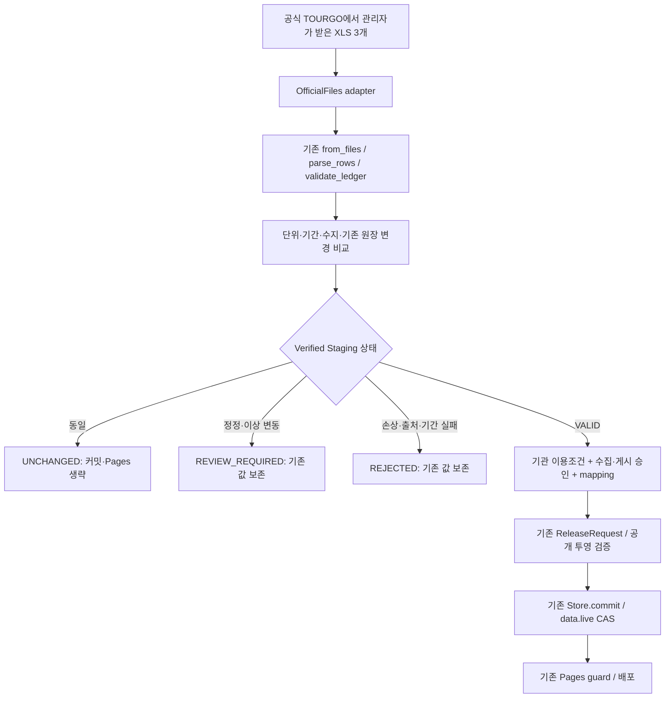

# Macro Monitor Data Pipeline v2

본 PR은 구조 개선입니다. **운영 승인·Secrets·보호 환경·data/live·Pages·공식 운영 JSON을 변경하지 않았습니다.**

기준 main `a3c0f3c`에는 PR #39~#41이 반영되어 있습니다. 기능을 다시 만들지 않고 두 파일(`tourgo_staging.py`, `tourgo_update.py`)로 실제 입력·검증·반복 운영의 책임을 분리했습니다. 별도 배포 시스템/유료 인프라/미사용 추상 프레임워크를 만들지 않았습니다.

## v1 구조와 위험 분석

| 기존 계층 | 보호하는 위험 | 문제와 v2 처리 |
| --- | --- | --- |
| PR #39 `tourgo_release.stage` | 원본/단위/69개월/수지 검증, 최신 Macro와 Preview의 정합성, 기존 KTO 보존 | 그대로 재사용. 최초/명시적 정정 검토 단계의 staging과 반복 갱신용 내부 staging을 구분 |
| PR #40 `ReleaseRequest` | 오래된 원장·코드·입력·승인·공개 투영의 재사용 방지 | 제거하지 않음. 반복 경로도 매 시도 최신 원장에서 자동 생성한 영수증으로 **동일 검증** 수행 |
| 6파일 private handoff | 공개 저장소/artifact에 원본·비공개 원장 노출 방지, 검토된 초기 원본의 신뢰 | 최초 등록/검토된 정정에 유지. 프로그램이 원장·영수증·manifest 생성. 일반 월 갱신은 원본 3개 + source + manifest만 업로드 |
| 초기 commit/manifest SHA Secret pin | 최초 검토된 외부 패키지의 대체 방지 | 초기/정정 경로에 유지. 일반 반복 갱신은 전용 private `updates` branch를 한 번 해석한 commit으로 고정하고 서명·소유자 확인. 매월 Secret 수정 불필요 |
| 초기 `operating_configuration` | 수집 승인을 게시 승인으로 오인하지 않음, ECOS 혼합 차단 | 기존 게시 검증 유지. private 수집/staging은 별도의 기관 이용조건+수집 승인으로 검사하여 게시 승인과 분리 |
| PR #41 solo gate | 타인 실행·우회·다른 branch 배포 방지 | 동일 owner ID·실제 10분 이상 Wait Timer·관리자 bypass 금지·main 전용. 신규 workflow 이름만 명시적으로 추가 |
| Store/CAS/Pages guard | 동시 데이터 손실, stale Pages 배포 방지 | 변경하지 않음. 재시도마다 최신 원장으로 비교/staging/영수증 재생성 |
| Due Engine | 뉴스/리서치/지표의 자동화 누락 복구 | 일반 실행은 그대로. 명시적 v2 요청이 UNCHANGED/검토/실패이면 트랜잭션에 들어가지 않고 종료, 다른 정기 job은 기존대로 실행 |

`tourgo.terms_confirmed()`를 공통화하여 비공개 수집 게이트와 기존 공개 투영 양쪽에 적용했습니다. 기관 이용조건이 검토/철회 상태로 바뀌면 owner 게시 승인만 남아 있어도 기존 공개 금액은 차단합니다. 원장·정정 이력은 삭제하지 않습니다.

권리/승인/원본/전송/배포 검사는 중복되는 문자열 검사처럼 보여도 서로 다른 위험을 보호합니다. 원본 재파싱·영수증·publication gate를 제거하지 않았습니다. 사람의 반복 파일 조합을 프로그램으로 옮기고, 수집 승인과 게시 승인 결합만 분리했습니다.

## 데이터 흐름

### Source Adapter와 정규화

`OfficialFiles`가 최초/반복/명시적 정정 모두에서 사용됩니다. 기존 `tourgo.from_files` → `balance.read_xls/parse_rows` → 원장 검증을 한 경로로 재사용합니다.

- 최초: 기존 고정 원본 SHA 3개, 정확히 2021-01~2026-09 69개월.
- 반복: owner가 검토한 공식 파일 + 신뢰된 private commit. 해시는 전송 무결성만 의미하며 공식성 자체를 보증하지 않음.
- 출처/유형: 고정 TOURGO URL·기관·general_travel_monthly·천 US$·관리자 공식 export 확인. 다른 source.json·혼합 출처는 거부.
- 기존 원장: `saved_ledger()`는 TOURGO 쌍만 복원. ECOS/잘못된 단위/불완전한 수입·지출 쌍은 거부.
- 원본 천 US$를 보존하고 기존 엔진의 정확한 정수 US$ 환산·백만 US$ 표시는 유지.
- 중복·미래월·연계 불일치·수지 항등식·월 누락·기존 월 소실·공식 상태 변경 검증. 보간/임의 0/잠정·확정 추정 없음.
- 기존 최초 수집 시각과 원장 정정 이력은 유지. 원본 vintage SHA와 실제 수집 시각은 기존 provenance로 관리.

현재 구체적으로 지원하는 신규 입력은 TOURGO XLS입니다. KTO 공식 파일 adapter·ECOS API adapter는 기존 엔진/모델을 유지합니다. 미래 API/CSV adapter도 검증된 월별 ledger/snapshot 경계로 추가할 수 있지만, 검증되지 않은 API/CSV 기능을 구현 완료로 표시하지 않습니다.

### 검증 상태

| status | 의미 / 처리 |
| --- | --- |
| `VALID` | 정상 새 월 + 이용조건·수집·게시 승인·활성 mapping 확인. 기존 트랜잭션으로 전달 가능 |
| `UNCHANGED` | 기존 값/상태와 동일하고 게시 조건 유효. 수집 시각·원장/정정/health·Git/Pages 변경 없음 |
| `REVIEW_REQUIRED` | 과거 값/잠정·확정 정정, 비정상 변동, 권한 누락/만료, mapping 미활성. 비공개 검토만, 운영 쓰기 없음 |
| `REJECTED` | 해시/원본/단위/기간/출처/항등식 등 필수 검증 실패. 운영 쓰기 없음 |

`data_status`는 품질 결과이고 최종 `status`와 `publication_allowed`는 권한/mapping까지 반영합니다. 품질 VALID나 수집 승인만으로 게시하지 않습니다. 새 공개 UI 필드를 추가하지 않고 `result.json`/Actions Summary의 고정 상태·사유·건수로 기록합니다.

신규 월은 연속된 전체 기간을 요구합니다. 기존 월의 값 또는 최종 상태가 하나라도 달라지면 검토가 필요합니다. 새 월 수입/지출의 전월 대비 절대 변동이 75%를 넘거나 0에서 유의한 값으로 바뀌면 검토 대상으로 처리합니다(정수 비교). 이는 통계 오차 판정이 아니라 운영자 점검 기준입니다. 최초 검토한 69개월의 과거 급변을 일괄 거부하지 않습니다. 관광수지에는 퍼센트 변화율을 적용하지 않습니다.

## 최초 등록과 반복 갱신

### Initial Bootstrap / 명시적 정정 검토

`release-package`가 원본 검증 + Preview + ledger/receipt/manifest 6파일 handoff를 자동 생성합니다. 기존 `tourgo-publish.yml`의 고정 private commit·manifest SHA, 수동 확인·보호 환경·ReleaseRequest 계약을 유지합니다. `profile=initial`이 기본이고, 실제 통계 정정을 검토한 경우에만 `profile=update`로 같은 경로를 사용합니다. source 운영 승인은 다시 만들지 않으며 기존 유효한 승인을 검사합니다.

### Recurring Update

1. 관리자가 공식 전체 시계열 XLS 3개를 받습니다.
2. `source-package --official-source-reviewed`가 원본 3개 + `source.json` + `manifest.json`을 생성합니다. **원장/영수증/해시 수동 조합이 없습니다.**
3. 기존 private repo의 전용 `updates` branch 루트에 5파일을 GitHub 웹 UI로 업로드합니다(서명된 owner commit).
4. 수동 `TOURGO recurring update (manual)` 실행. 기존 보호 환경·공유 lock 안에서 branch를 commit으로 한 번 고정하고 API의 `author.id`와 검증된 서명을 확인합니다.
5. 최신 data/live에서 원장 비교 후 새 staging/영수증을 자동 생성합니다. 정상 신규 월만 기존 ReleaseRequest/transaction으로 전달합니다.

월별 Secret/manifest 해시 복사는 필요하지 않습니다. runtime에 Secret을 쓰는 API·새 write token도 없습니다. 무서명/다른 author/private 미확인/전송 손상은 차단합니다. 로컬 unsigned commit을 자동으로 신뢰하지 않으며, GitHub 웹 업로드 또는 검증 가능한 owner 서명 commit을 사용해야 합니다. 서명을 쓸 수 없으면 검토한 예외를 기존 고정 SHA 수동 경로로 처리합니다.

현재 자동 TOURGO 원문 다운로드/cron은 없습니다. source.json의 확인 플래그·자동 manifest만으로 원본을 신뢰하지 않으며, 공식 원본을 확인하는 owner의 책임과 private/서명 신뢰 경계를 유지합니다.

## 승인·보호·영속성

기관 이용조건 확인, owner 수집 승인, owner 게시 승인을 독립 검사합니다. 매달 재승인을 요구하지 않고 범위·유효기간·비상업/무료/무광고/출처표시·데이터 유형을 검사합니다. 이용조건/출처/유형 변경, 정정·급변은 별도 검토가 필요합니다.

사용자는 이번 지시에서 **수집 승인, 게시 미승인**을 명시했습니다. 최신 main의 실제 JSON은 source enabled/collection/publication 모두 false·근거/기간 null입니다. 이 PR은 이를 그대로 보존합니다. 수집 승인이 이미 부여됐다는 사실과 날짜·범위를 설정에 기록하는 작업은 구별합니다. 실행 시 dated collection 설정이 없으면 private API를 읽기 전 차단합니다. 이것은 새로운 수집 승인을 매번 요청하는 정책이 아닙니다. 게시 승인·활성 mapping 없이는 private staging을 넘어갈 수 없습니다.

GitHub live 환경 조회에서는 `tourgo-production`에 Wait Timer가 보이지 않고 `can_admins_bypass=true`로 반환됐습니다. 사용자가 지정한 현재 정책(10분 timer·bypass 금지·main 전용)을 준수하는 코드를 유지하며, 이 관측 차이를 우회하거나 설정을 변경하지 않았습니다. 실제 실행 전 소유자의 확인이 필요합니다. Wait Timer는 독립적인 사람의 승인이 아니며 최종 게시 승인을 대체하지 않습니다.

- CAS 충돌: News만 바뀌면 보존 후 재시도. Macro가 바뀌면 최신 원장으로 재평가. 동시 신규 월이 정정 충돌로 바뀌면 검토로 중단.
- 초기/정정 영수증: baseline/구현/입력 fingerprint가 바뀌면 기존처럼 재staging 필요.
- 동일 데이터: Store.commit/collector/Pages를 호출하지 않음. 새 code/data head 검사 후 종료.
- 검증/검토 실패: 기존 data/live 전체 유지. 기존 정기 News/Research/Macro job은 영향 없음.
- 게시 승인 철회/만료: 수집 경로에서는 게시 차단. 기존 일반 policy 재투영/배포가 이전 공개 금액도 제거하며 private 원장은 보존.
- Git 저장 후 Pages 실패: 기존 검증된 Git vintage를 삭제하지 않음. 저장/배포를 구분해 기존 deploy workflow로 최신 head 재검증 후 복구.

## 실제 공급원 조사 / 잔여 제약

실제 HTTP 결과는 [source-access.json](source-access.json)에 기록했습니다.

| 공식 경로 | 결과 | 판정 |
| --- | --- | --- |
| TOURGO 공식 관광수입·지출 화면 | 200 HTML, redirect 없음 | 공식 화면 접근 확인. JavaScript export 및 form 제출 구조. 안정적 공식 API/직접 XLS URL 문서 미확인 |
| TOURGO robots.txt | 200; Googlebot에 `/customer/qna/` 제한 | 파일 재사용·자동 다운로드 허가 자체를 뜻하지 않음 |
| 공공데이터포털 영문 15111606 명세 | 503 | 이번 환경에서 확인 불가. 미운영이라고 단정하지 않음 |
| 등록된 `getTourismBalcList`의 HTTPS 무인증 YM 조회 | 503 | 인증/TLS 기반 실제 API·최신 월 운영 검증 미완료. 키 전송 없음 |

공식 HTML에는 `excelExportStat_merge_on/off` 함수 호출과 browser form 기반 export 설명이 있었습니다. 내부 AJAX/API 경로를 추측하거나 호출하지 않았습니다. 안정적 문서·실제 응답 검증 전까지 관리자 파일 방식으로 fallback합니다.

지정 해시 원본은 이 환경에 없으므로 [실원본 검증 미실시](real-input-status.json)입니다. private 저장소 입력이나 Secrets를 개발 환경에 가져오지 않았으며 보호 전달의 end-to-end 운영 성공도 보고하지 않습니다.

[운영 매뉴얼](OPERATOR-RUNBOOK.md) · [검증 결과](VALIDATION.md).
